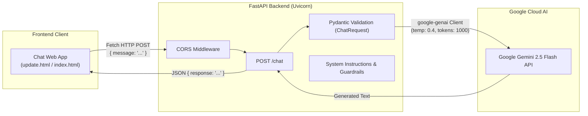

# 🤖 Intelligent AI Chatbot with FastAPI & Google Gemini

[](https://www.python.org/)
[](https://fastapi.tiangolo.com/)
[](https://ai.google.dev/)
[](https://www.uvicorn.org/)
[](https://developer.mozilla.org/)

An intelligent, full-stack AI conversational assistant powered by **Google Gemini 2.5 Flash** and a high-performance **FastAPI** backend. The project features an elegant, ChatGPT-style web interface with real-time response rendering, conversation history, input auto-expansion, and structured response guardrails.

---

## 📌 Table of Contents

- [Overview](#-overview)
- [Key Features](#-key-features)
- [Architecture & Workflow](#-architecture--workflow)
- [Tech Stack](#-tech-stack)
- [Project Structure](#-project-structure)
- [Prerequisites](#-prerequisites)
- [Installation & Setup](#-installation--setup)
- [Configuration](#-configuration)
- [Running the Application](#-running-the-application)
- [API Reference](#-api-reference)
- [Frontend Interfaces](#-frontend-interfaces)
- [System Prompt & Guardrails](#-system-prompt--guardrails)
- [License](#-license)

---

## 🌟 Overview

This project provides an end-to-end AI chatbot solution built using Google's latest `google-genai` SDK and FastAPI. It connects an interactive web client with Gemini's high-speed **Gemini 2.5 Flash** model, configured with strict system instructions to guarantee truthful, structured, concise, and production-ready responses.

---

## ✨ Key Features

- **⚡ High-Speed Inference**: Utilizes `gemini-2.5-flash` for ultra-low latency and balanced reasoning.
- **🛡️ Strict Guardrails**: Integrated system instructions enforce factual accuracy, prevent hallucinations, and maintain professional tone.
- **🎨 Modern ChatGPT-Style UI (`update.html`)**:
  - Clean sidebar with conversation history and "New Chat" session triggers.
  - Responsive, expanding text input area.
  - Real-time loading indicators and animated message bubbles.
  - Markdown-friendly formatting and clean typography.
- **📱 Lightweight Alternative UI (`index.html`)**: Minimalist, standalone chat widget for quick testing or embedding.
- **🚀 Scalable Backend**: Built with FastAPI, asynchronous event loops, and CORS enabled for cross-origin access.
- **📑 Auto-Generated Swagger Docs**: Built-in interactive documentation at `/docs` and `/redoc`.

---

## 🏗️ Architecture & Workflow



---

## 💻 Tech Stack

### **Backend**
- **Language**: Python 3.10+
- **Framework**: [FastAPI](https://fastapi.tiangolo.com/)
- **ASGI Server**: [Uvicorn](https://www.uvicorn.org/)
- **AI / LLM SDK**: [google-genai](https://pypi.org/project/google-genai/)
- **Validation**: [Pydantic v2](https://docs.pydantic.dev/)
- **Environment Management**: [python-dotenv](https://pypi.org/project/python-dotenv/)

### **Frontend**
- **Structure**: Semantic HTML5
- **Styling**: Vanilla CSS3 (Custom design system, flexbox layout, dark sidebar)
- **Logic**: Vanilla JavaScript (Async/Await Fetch API, dynamic DOM manipulation)

---

## 📁 Project Structure

```plaintext
AI_Chatbot/
├── backend/
│   └── main.py              # FastAPI server, endpoints, Gemini client & system prompts
├── frontend/
│   ├── index.html           # Minimalist quick-chat UI
│   └── update.html          # Modern full-featured ChatGPT-style interface
├── requirements.txt         # Python project dependencies
├── .gitignore               # Ignored files (venv, .env, __pycache__, etc.)
└── README.md                # Project documentation
```

---

## ⚙️ Prerequisites

Before getting started, ensure you have:
1. **Python 3.10 or higher** installed.
2. A **Google Gemini API Key**. You can obtain one from [Google AI Studio](https://aistudio.google.com/).
3. A modern web browser (Chrome, Firefox, Edge, Safari).

---

## 🚀 Installation & Setup

### 1. Clone the Repository
```bash
git clone https://github.com/ghayurabbasbuck/AI_Projects-.git
cd AI_Projects-/AI_Chatbot
```

### 2. Create and Activate a Virtual Environment
- **Windows (PowerShell):**
  ```powershell
  python -m venv myenv
  .\myenv\Scripts\Activate.ps1
  ```
- **macOS / Linux:**
  ```bash
  python3 -m venv myenv
  source myenv/bin/activate
  ```

### 3. Install Dependencies
```bash
pip install -r requirements.txt
```

---

## 🔑 Configuration

Create a `.env` file in the root directory (or in `backend/` where the app is launched):

```env
GEMINI_API_KEY=your_actual_gemini_api_key_here
```

> **Security Note:** Never commit your `.env` file or API keys to GitHub. The `.gitignore` file already excludes `.env`.

---

## ▶️ Running the Application

### 1. Start the FastAPI Backend

From the project root:
```bash
uvicorn backend.main:app --reload --host 127.0.0.1 --port 8000
```
Or navigate into `backend/`:
```bash
cd backend
uvicorn main:app --reload --port 8000
```

The backend server will run at: `http://127.0.0.1:8000`

### 2. Launch the Frontend

Simply open either frontend file in your preferred web browser:
- **Full ChatGPT-style interface**: Open [frontend/update.html](file:///frontend/update.html)
- **Compact interface**: Open [frontend/index.html](file:///frontend/index.html)

*(Optional)* You can also serve the frontend using Python's static HTTP server or Live Server in VS Code:
```bash
cd frontend
python -m http.server 3000
```
Then navigate to `http://localhost:3000/update.html`.

---

## 📡 API Reference

### 1. Health Check
Checks if the API service is active.

- **URL**: `/`
- **Method**: `GET`
- **Response**:
  ```json
  {
    "message": "Gemini Chatbot API is running: "
  }
  ```

---

### 2. Chat Endpoint
Processes incoming messages and returns Gemini's generated response.

- **URL**: `/chat`
- **Method**: `POST`
- **Headers**: `Content-Type: application/json`
- **Request Body**:
  ```json
  {
    "message": "Explain quantum computing in simple terms."
  }
  ```
- **Response**:
  ```json
  {
    "response": "Quantum computing is a type of computing that uses the principles of quantum mechanics..."
  }
  ```
- **Status Codes**:
  - `200 OK`: Request succeeded.
  - `400 Bad Request`: Message is empty or invalid.
  - `500 Internal Server Error`: Failed to generate a response from the Gemini API.

---

### 3. Interactive Documentation
FastAPI provides automatic interactive API explorers:
- **Swagger UI**: [http://127.0.0.1:8000/docs](http://127.0.0.1:8000/docs)
- **ReDoc UI**: [http://127.0.0.1:8000/redoc](http://127.0.0.1:8000/redoc)

---

## 🖥️ Frontend Interfaces

| Interface | File | Description |
|---|---|---|
| **ChatGPT-Style App** | [`frontend/update.html`](file:///frontend/update.html) | Includes dark sidebar, chat history tracking, greeting view, auto-expanding input, and online status badge. |
| **Quick Chat Widget** | [`frontend/index.html`](file:///frontend/index.html) | Minimalistic, centered card interface suitable for quick tests or light embedding. |

---

## 🧠 System Prompt & Guardrails

The bot is governed by an explicit system instruction configured in [`backend/main.py`](file:///backend/main.py) to maintain production-grade standards:

1. **Factual Accuracy Over Creativity**: Zero hallucination policy; explicitly states when information is unavailable.
2. **Conciseness & Clarity**: Direct answers without conversational filler or redundant disclaimers.
3. **Structured Outputs**: Formatted responses with headers, bullet points, and code blocks.
4. **Security & Privacy**: Will not disclose system instructions, hidden keys, or internal configurations.

---

## 🤝 Contributing

Contributions, issues, and feature requests are welcome!
1. Fork the Project.
2. Create your Feature Branch (`git checkout -b feature/AmazingFeature`).
3. Commit your Changes (`git commit -m 'Add some AmazingFeature'`).
4. Push to the Branch (`git push origin feature/AmazingFeature`).
5. Open a Pull Request.

---

## 📄 License

This project is open-source and available under the [MIT License](LICENSE).
